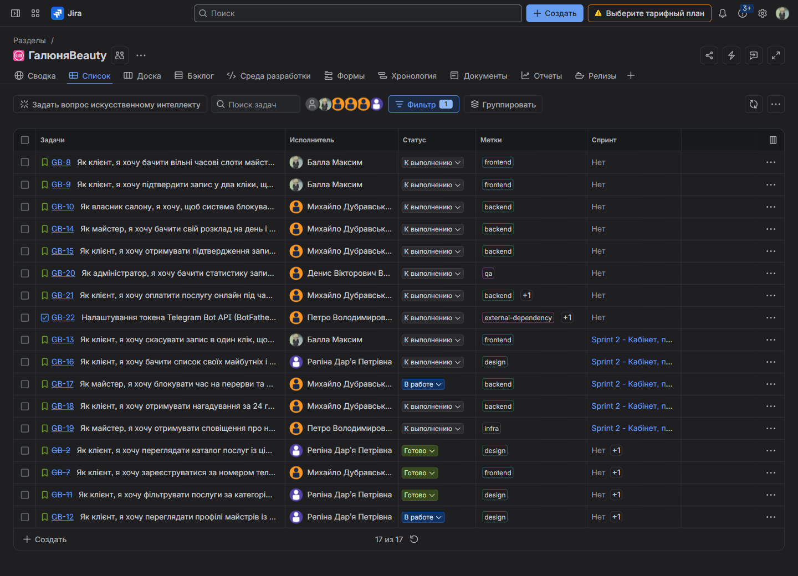
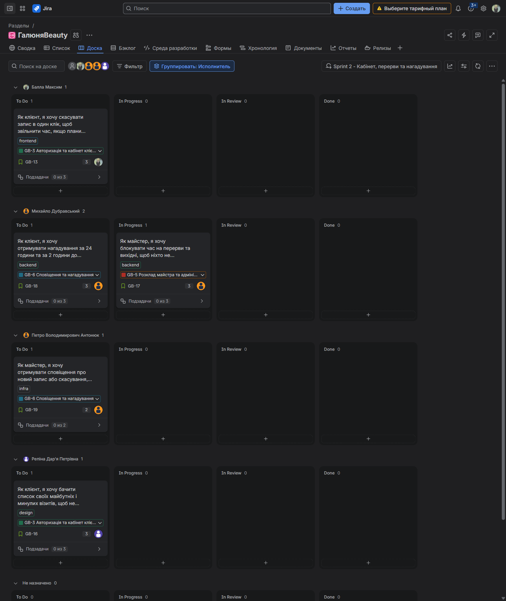
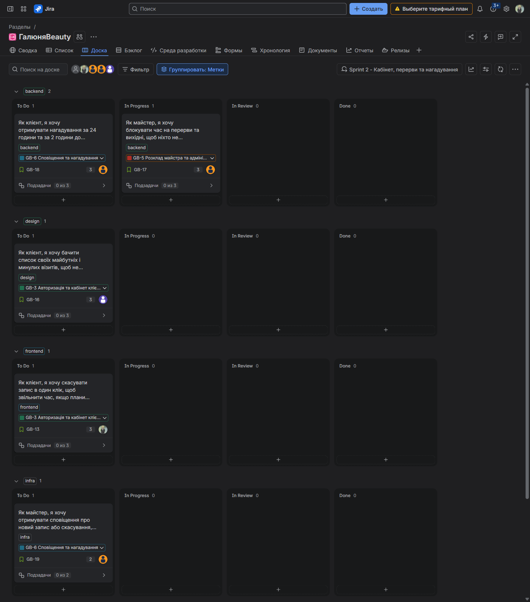
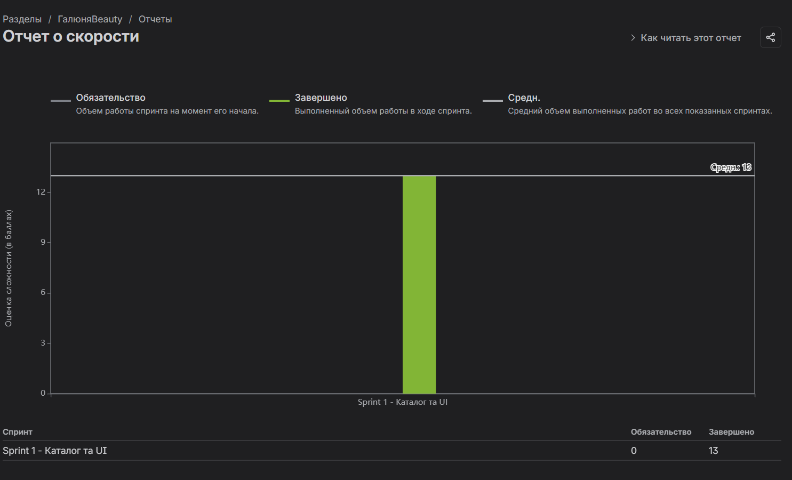
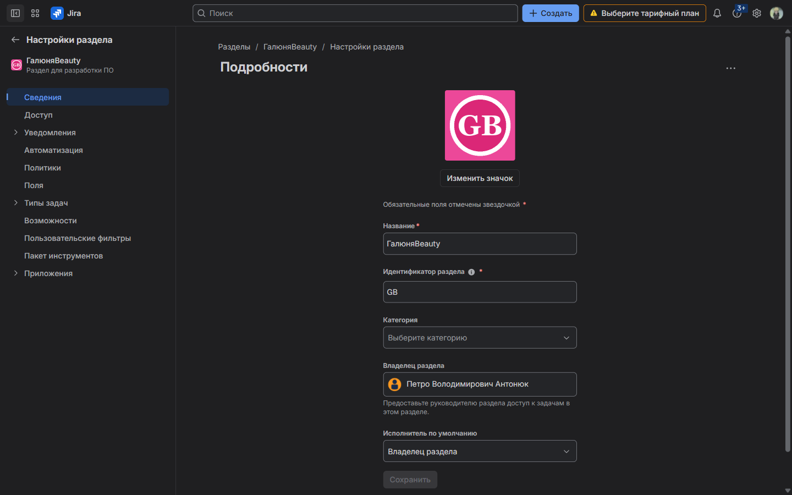

# Управління ресурсами проєкту ГалюняBeauty

**Команда:** Антонюк Петро, Балла Максим, Михайло Дубравський, Репіна Дар'я, Денис Войтенко | **Jira:** [ГалюняBeauty (GB)](https://mksmballa.atlassian.net/jira/software/projects/GB/boards/3) | **Дата:** 25.11.2026

---

## 2.1. Склад команди

| Учасник | Ролі в проєкті | Доступність (FTE) | Годин на тиждень |
|---------|----------------|:-----------------:|:----------------:|
| Михайло Дубравський | Backend + API / Telegram | 0.30 | 12 |
| Балла Максим | Tech Lead + Frontend | 0.25 | 10 |
| Антонюк Петро | PM + Infra | 0.20 | 8 |
| Репіна Дар'я | Designer + UI | 0.20 | 8 |
| Денис Войтенко | Analyst + QA | 0.20 | 8 |
| **Разом** | **5 учасників** | **1.15** | **46** |

Доступність розрахована від стандартної повної ставки 40 год/тиждень з урахуванням навчального навантаження (пари, лабораторні роботи та підготовка до заліків). У Jira (`Space settings → Access`) усі учасники команди додані з відповідними правами: `Антонюк Петро` (PM) та `Балла Максим` (Tech Lead) мають роль **Administrator**, `Михайло Дубравський`, `Репіна Дар'я` та `Денис Войтенко` — роль **Member**.

---

## 2.2. Capacity на спринт

| Параметр | Значення | Коментар |
|----------|----------|----------|
| Тривалість спринту | 2 тижні | Поточний активний Sprint 2: `16.11.2026 – 30.11.2026` |
| Σ годин команди на спринт | 92 год | 46 год/тиждень × 2 тижні (з таблиці 2.1) |
| Коефіцієнт на непродуктивний час (мітинги, рев'ю) | −20% | −18.4 год на планування, стендапи, код-рев'ю та узгодження |
| Ефективна Capacity | 73.6 год | 92 × 0.8 |
| Velocity (факт, Sprint 1) | 13 SP | З Velocity report (`GB-2`, `GB-7`, `GB-11` у Done) |
| Годин на 1 SP | 5.66 год/SP | 73.6 год ÷ 13 SP (Capacity ÷ Velocity)* |
| Плановий обсяг наступного спринту (Sprint 3) | 10 SP | `GB-12` (5 SP) + `GB-14` (5 SP) з урахуванням залікового тижня |

*\*За декомпозицією 14 Subtasks активного Sprint 2 (14 SP) чистий інженерний час за `Original Estimate` становить `45 год ÷ 14 SP = 3.21 год/SP`. Різниця між `5.66` і `3.21 год/SP` покриває тестування, виправлення багів, комунікацію та навчальний буфер команди.*

---

## 2.3. Skills Matrix

Оцінка навичок: `0` — немає, `1` — базовий, `2` — впевнений, `3` — сильний.

| Навичка | Антонюк Петро | Балла Максим | Михайло Дубравський | Репіна Дар'я | Денис Войтенко | Потрібний рівень | Ризик |
|---------|:-------------:|:------------:|:-------------------:|:------------:|:--------------:|:----------------:|-------|
| React / Frontend | 1 | 3 | 2 | 1 | 0 | ≥2 | Середній (2 учасники ≥2) |
| Node.js / Backend + Telegram API | 1 | 2 | 3 | 0 | 0 | ≥2 | Середній (2 учасники ≥2) |
| Бази даних | 1 | 2 | 3 | 0 | 1 | ≥2 | Середній (2 учасники ≥2) |
| Тестування (QA) | 2 | 2 | 2 | 1 | 3 | ≥1 | Низький (5 учасників ≥1) |
| DevOps / Деплой | 1 | 1 | 3 | 0 | 0 | ≥1 | Високий (рівень ≥2 лише у 1 особи) |
| Дизайн / Figma | 0 | 1 | 0 | 3 | 1 | ≥1 | Високий (рівень ≥2 лише у 1 особи) |
| Git / Code Review | 2 | 3 | 2 | 2 | 2 | ≥2 | Низький (усі 5 учасників ≥2) |

---

## 2.4. Аналіз Skills Matrix

| Питання | Відповідь |
|---------|-----------|
| Яка навичка покрита лише однією людиною? | Дизайн / Figma на робочому рівні (≥2) має лише Репіна Дар'я (оцінка 3). Самостійний DevOps / деплой і налаштування серверного оточення для Telegram Bot API на рівні ≥2 є лише у Михайла Дубравського (оцінка 3); Антонюк Петро та Балла Максим мають базовий рівень 1. |
| Який Bus Factor у критичних зонах? | У зонах `design` та `infra` (налаштування хостингу й серверної конфігурації бота) Bus Factor = **1**. У зонах `frontend`, `backend` і роботі з БД Bus Factor = **2** (Балла Максим і Михайло Дубравський можуть підстрахувати один одного). У `qa` та `Git` Bus Factor ≥ **3**. |
| Яка навичка потрібна, але відсутня/слабка? | Практичний DevOps / налаштування оточення і деплою у більшості учасників команди (максимум 1 бал у 4 з 5 учасників). Це створює ризик затримки на задачі `GB-22` (Telegram Bot API та тестовий хостинг), яка блокує `GB-15`, `GB-18` і `GB-19`. |
| План закриття розриву (хто що вчить, до якого спринту) | 1. Антонюк Петро разом із Михайлом Дубравським описує інструкцію деплою та налаштування `.env` / BotFather (`GB-22`) і виконує тестовий деплой до кінця Sprint 2 (`30.11.2026`), піднімаючи DevOps до рівня 2. 2. Репіна Дар'я створює спільну бібліотеку UI-компонентів у Figma до кінця Sprint 2 (`30.11.2026`), щоб Балла Максим міг самостійно збирати екрани календаря (`GB-8`, `GB-9`) у Sprint 4. 3. Балла Максим і Михайло Дубравський проводять взаємний Code Review кожного PR у `frontend` і `backend` протягом Sprint 2–4. |

---

## 2.5. Зони відповідальності (Labels)

У team-managed проєкті Jira (`GB`) немає `Components`, тому технічні зони закріплені через `Labels`. Прийняте правило: кожна задача проєкту має рівно один label зони (`backend`, `frontend`, `design`, `qa` або `infra`). Службові мітки з попередніх лабораторних (`wont-have` на `GB-21`, `external-dependency` на `GB-22`) збережені разом із відповідним label зони.

| Label | Area Lead | К-сть задач | Що входить |
|-------|-----------|:-----------:|------------|
| `backend` | Михайло Дубравський | 14 | API, БД, бізнес-логіка, захист від овербукінгу, інтеграція Telegram Bot API (`GB-4`, `GB-5`, `GB-10`, `GB-14`, `GB-15`, `GB-17`, `GB-18`, `GB-21`, `GB-23`, `GB-26`, `GB-30`, `GB-32`, `GB-33`, `GB-35`) |
| `frontend` | Балла Максим | 8 | UI-компоненти, форми, календар слотів, особистий кабінет (`GB-3`, `GB-7`, `GB-8`, `GB-9`, `GB-13`, `GB-24`, `GB-27`, `GB-31`) |
| `design` | Репіна Дар'я | 6 | Макети Figma, UX-сценарії, Mobile-First каталог і картки (`GB-1`, `GB-2`, `GB-11`, `GB-12`, `GB-16`, `GB-29`) |
| `qa` | Денис Войтенко | 5 | Тестування, верифікація AC, перевірка крайніх випадків, аналітика (`GB-20`, `GB-25`, `GB-28`, `GB-34`, `GB-36`) |
| `infra` | Антонюк Петро | 3 | Деплой, тестовий хостинг, токен BotFather, координація релізів (`GB-6`, `GB-19`, `GB-22`) |
| **Разом** | **5 зон** | **36** | Усі 5 Epics, 16 Stories, 1 Task, 14 Subtasks |

Перевірка фільтрами Jira:
- `project = GB AND labels is EMPTY` → **0 задач**.
- `project = GB AND assignee is EMPTY` → **0 задач**.
- `Space settings → Details`: Space owner = **Петро Володимирович Антонюк (PM)**, Default assignee = **Space owner (`PROJECT_LEAD`)**.

---

## 2.6. Аналіз Workload (з Jira)

Дані знято з активного **Sprint 2** (`5 Stories` на `14 SP` + `14 Subtasks` на `45 год Original Estimate` = `19 задач`) та завершеного **Sprint 1** (`18 SP committed`, `13 SP done`). Поле Time tracking увімкнене; на поточному етапі Sprint 2 у роботі знаходиться `GB-17` / `GB-23`, зафіксований `Time Spent = 0 год` по команді (ведення щоденного обліку розпочато зі Sprint 2).

| Учасник | Задач у спринті (Sprint 2) | SP committed (Sprint 2) | SP done (Sprint 1) | % виконання (Sprint 1) | Висновок |
|---------|:--------------------------:|:-----------------------:|:------------------:|:----------------------:|----------|
| Михайло Дубравський | 6 (2 Stories + 4 Subtasks; 16 год) | 6 SP | 5 SP (`GB-7`, 5/5) | 100% | Завантажений на 83% ефективної Capacity (19.2 год); веде `backend` (API та Telegram Bot API), у Sprint 5 потрібен розподіл навантаження на `GB-10`/`GB-15` |
| Балла Максим | 5 (1 Story + 4 Subtasks; 14 год) | 3 SP | 0 SP* | — | Завантажений на 88% ефективної Capacity (16.0 год); веде `frontend` (`GB-13`, `GB-24`, `GB-27`) і підстраховує `backend` (`GB-23`, `GB-26`) |
| Денис Войтенко | 4 (0 Stories + 4 Subtasks; 9 год) | 0 SP** | 0 SP (`GB-12`, 0/5) | 0% | Завантажений на 70% ефективної Capacity (12.8 год); у S1 не закрив непрофільну дизайн-історію `GB-12`, у S2 сфокусований на `qa` |
| Репіна Дар'я | 3 (1 Story + 2 Subtasks; 6 год) | 3 SP | 8 SP (`GB-2`, `GB-11`, 8/8) | 100% | Завантажена на 47% ефективної Capacity (12.8 год); має буфер часу для доробки `GB-12` та підготовки макетів Sprint 3 |
| Антонюк Петро | 1 (1 Story + 0 Subtasks; +2 год `GB-22`) | 2 SP | 0 SP* | — | Веде `infra` (`GB-19`, `GB-22`) та PM-організацію спринту; має запас на контроль залежностей і приймальне тестування |
| **Разом** | **19 (5 Stories + 14 Subtasks; 45 год)** | **14 SP** | **13 SP (з 18 SP)** | **72.2%** | Навантаження у Sprint 2 узгоджене з Capacity та зонами відповідальності |

*\*У Sprint 1 Балла Максим і Антонюк Петро виконували налаштування репозиторію, тестового оточення, структури проєкту та Jira-беклогу, які не оцінювалися окремими User Stories.*
*\*\*У Jira Scrum Story Points виставляються лише на рівні Stories, тому QA-інженер у Sprint 2 має 0 Story-level SP, але відповідає за 4 Subtasks (`GB-25`, `GB-28`, `GB-34`, `GB-36`, сумарно 9 год) по всіх історіях спринту.*

---

## 2.7. Вирівнювання завантаження

| Виявлена проблема | Рішення | Результат |
|-------------------|---------|-----------|
| У Sprint 1 історія `GB-12` (профілі майстрів, 5 SP) була закріплена за QA-аналітиком (Денисом Войтенком) і залишилась незавершеною | Перепризначили `GB-12` на Area Lead зони `design` (Репіну Дар'ю) і запланували завершення у Sprint 3 | Денис зосередився на `qa`; `GB-12` повернулася у свою технічну зону |
| У Sprint 2 частина задач не відповідала зонам: `GB-19` (Telegram-сповіщення) висіла на дизайнері, `GB-16` та `GB-31 [FE]` — на QA, а `[QA]`-підзадачі `GB-28`, `GB-36` — на PM | Вирівняли призначення за Labels: `GB-19` → Петро (`infra`), `GB-16` і `GB-31` → Дар'я (`design`/`frontend`), `GB-13`, `GB-24`, `GB-27` → Максим (`frontend`), `GB-17`, `GB-18`, `GB-33`, `GB-35` → Михайло (`backend`), `GB-28` і `GB-36` → Денис (`qa`) | Усі 36 задач відповідають своїм зонам та Area Leads; 0 невідповідних призначень |
| Зона `backend` у Sprint 2 накопичила 6 підзадач на 24 год — при виконанні одним розробником Михайло Дубравський перевищив би власну Capacity (19.2 год) на 25% | За домовленістю 2 backend-підзадачі (`GB-23` API перерв, `GB-26` ендпоінт скасування — разом 8 год) залишили за Баллою Максимом, а Михайло сфокусувався на Telegram Bot API, cron та БД (`GB-30`, `GB-32`, `GB-33`, `GB-35` — 16 год) | Михайло має 16 год (83% Capacity), Максим — 14 год (88% Capacity); різниця завантаження розробників склала 5% |
| У налаштуваннях Jira `Default assignee` був `Unassigned`, тож нові задачі створювалися без відповідального | У `Space settings → Details` призначили Space owner = Антонюк Петро (PM) та `Default assignee` = Space owner | Жодна нова задача не губиться без виконавця (`assignee is EMPTY` = 0) |

---

## 2.8. Ресурсний план по спринтах

| Спринт | Період | Потрібні зони | Capacity (год) | Особливості |
|--------|--------|---------------|:--------------:|-------------|
| Sprint 3 | 30.11.2026 – 14.12.2026 | `design` (`GB-12` 5 SP), `backend` (`GB-14` 5 SP), `qa` | 62.0 год | Початок залікового тижня (−15% доступності команди); плановий обсяг знижено до 10 SP для гарантованого закриття критичної `GB-14` |
| Sprint 4 | 14.12.2026 – 28.12.2026 | `frontend` (`GB-8` 8 SP, `GB-9` 5 SP), `backend`, `qa` | 58.0 год | Зимова сесія та іспити (−20% доступності); пікове навантаження на `frontend` (Балла Максим — 13 SP), потрібна допомога Михайла Дубравського у верстці або перенесення частини `Should Have` |
| Sprint 5 | 28.12.2026 – 11.01.2027 | `backend` (`GB-10` 8 SP, `GB-15` 5 SP), `qa`, `infra` | 73.6 год | Релізний спринт `v1.0-MVP`: захист від овербукінгу, Telegram-підтвердження, фінальне тестування та деплой |

---

## 2.9. Скріншоти з Jira

| № | Що на скріншоті | Файл |
|:-:|-----------------|------|
| 1 | Backlog / Список з Labels | [`docs/img/lab9-labels.png`](docs/img/lab9-labels.png) |
| 2 | Board по Assignee | [`docs/img/lab9-workload.png`](docs/img/lab9-workload.png) |
| 3 | Board по Labels | [`docs/img/lab9-areas.png`](docs/img/lab9-areas.png) |
| 4 | Velocity report | [`docs/img/lab9-velocity.png`](docs/img/lab9-velocity.png) |
| 5 | Details → Default assignee | [`docs/img/lab9-default-assignee.png`](docs/img/lab9-default-assignee.png) |

---

## 2.10. Висновки команди

1. **Хто у команді перевантажений або недовантажений і чому?**
   Найвище технічне навантаження у Sprint 2 несуть розробники — Балла Максим (88% ефективної Capacity, 14 год Subtasks) та Михайло Дубравський (83% Capacity, 16 год Subtasks), оскільки 6 із 14 підзадач спринту належать до `backend` і 3 — до `frontend`. Після розподілу `backend`-підзадач (`GB-23` і `GB-26` — Максиму, а API/Telegram `GB-30`, `GB-32`, `GB-33`, `GB-35` — Михайлу) перевантаження знято. Репіна Дар'я (47% Capacity у Sprint 2) та Антонюк Петро мають запас часу, що виправдано структурою спринту: у Sprint 2 домінує API та Telegram-інтеграція, а їхній резерв спрямовується на доробку `GB-12`, макети для Sprint 3 та контроль зовнішньої залежності `GB-22`.

2. **Який Bus Factor і як його підвищуємо?**
   У ключовій розробці (`frontend`, `backend`, БД) Bus Factor дорівнює 2 завдяки взаємозамінності Балли Максима та Михайла Дубравського. Вузькі місця з Bus Factor = 1 виявлено у двох зонах: `design` (Figma на робочому рівні лише у Репіної Дар'ї) та `infra / DevOps` (серверний деплой на рівні 3 лише у Михайла Дубравського). До кінця Sprint 2 підвищуємо Bus Factor до 2 у цих зонах через спільну документацію деплою і тренувальний деплой Антонюка Петра, а також через бібліотеку компонентів Figma для фронтенд-розробника (Балли Максима).

3. **Чи реалістична запланована кількість SP на наступний спринт при поточній Capacity?**
   Так. При ефективній Capacity 73.6 год і фактичній Velocity 13 SP (5.66 год/SP) плановий обсяг Sprint 3 у **10 SP** (`GB-12` + `GB-14`) є реалістичним навіть із урахуванням падіння доступності команди на 15% через заліковий тиждень (`62 год ÷ 5.66 ≈ 11 SP`). Водночас для Sprint 4 (13 SP на `frontend` під час сесії при Capacity 58 год) існує ризик недовиконання, тому команді потрібно заздалегідь залучити обох розробників до `GB-8`/`GB-9`.

4. **Яка зона має найбільше задач і чи відповідає це кількості людей у ній?**
   Найбільше задач у проєкті припадає на зону **`backend`** (API, БД, Telegram Bot API) — 14 із 36 задач (38.9% беклогу, з них 8 задач на 24 год у Sprint 2). Якби в цій зоні працювала одна людина, це створило б вузьке місце; зараз у `backend` фактично працюють двоє розробників (Area Lead Михайло Дубравський і підтримка Балли Максима), що дозволяє тримати завантаження обох у безпечних межах 83–88% Capacity.
